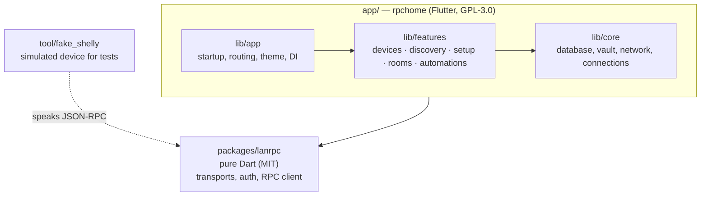

# Architecture

This document describes how RPCHome is organized and the rules that keep it
that way. Decisions behind it are recorded in [decisions/](decisions/).

## Big picture

```
Phone (RPCHome)  ──HTTPS / WebSocket / Bluetooth──▶  Device (/rpc endpoint)
```

The app sends JSON-RPC 2.0 requests to devices on the local network. It never
contacts a cloud service. Schedules, scenes and links are written to the
devices, which run them on their own: **the app configures, the device runs.**

## Packages



| Package | Responsibility | Depends on |
| --- | --- | --- |
| `app/lib/app` | Startup, routing, theme, dependency wiring | `features`, `core` |
| `app/lib/features/*` | One folder per user-facing feature | `core`, `lanrpc`, other features' `services` and `models` |
| `app/lib/core` | Infrastructure shared by features: local database, secure vault, network status, device connections | `lanrpc` |
| `app/lib/shared` | Reusable widgets and UI helpers | — |
| `app/lib/l10n` | Translations | — |
| `packages/lanrpc` | JSON-RPC client: transports, digest authentication, typed errors | Dart SDK only |
| `tool/fake_shelly` | HTTP/WebSocket server that imitates a device, used by tests | `lanrpc` (models only) |

## Layers inside a feature

```
ui  ──▶  controllers  ──▶  services  ──▶  repositories   (local SQLite)
                                     └──▶  lanrpc         (the device)
models: plain data used by every layer
```

| Folder | Contains | Example |
| --- | --- | --- |
| `models/` | Immutable data classes | `Device`, `Component`, `Scene` |
| `repositories/` | Read and write local storage only | `DeviceRepository` |
| `services/` | Business logic; combines repositories and `lanrpc` | `DeviceService.toggle()` |
| `controllers/` | UI state (Riverpod) | `DeviceListController` |
| `ui/` | Screens and widgets | `DeviceListScreen` |

## Dependency rules

1. Dependencies point downwards only. `ui` never imports `repositories` or
   `lanrpc`.
2. A feature may import another feature's `services` and `models`, never its
   `ui` or `controllers`.
3. `core/` never imports from `features/`.
4. `packages/lanrpc` never imports Flutter or anything from `app/`.
5. Platform plugins (Bluetooth, mDNS, secure storage) are wrapped in a service
   behind an interface, so they can be replaced by fakes in tests.

### Bluetooth transport

`lanrpc` defines the `RpcTransport` interface and ships the `HttpsTransport` and
`WebSocketTransport` implementations. Bluetooth needs a Flutter plugin, so
`BleTransport` lives in `app/lib/features/setup/services/` and implements the
same interface. The RPC client does not know which transport carries a request.

## Errors

`lanrpc` exposes a sealed hierarchy, so the compiler forces callers to handle
every case. Device error codes follow the
[Shelly API documentation](https://shelly-api-docs.shelly.cloud/gen2/General/CommonErrors).

```
LanRpcException
├── TransportException              no response
│   ├── HostUnreachableException
│   ├── RequestTimeoutException
│   └── TlsException
├── AuthException                   401
├── ProtocolException               response is not valid JSON-RPC
└── DeviceException                 the device answered with an error
    ├── InvalidArgumentException      -103
    ├── DeadlineExceededException     -104
    ├── NotFoundException             -105
    ├── ResourceExhaustedException    -108
    ├── FailedPreconditionException   -109
    ├── UnavailableException          -114
    ├── MethodNotFoundException       404
    └── UnknownDeviceException        any other code
```

Every error type has a fixture with a real response in
`packages/lanrpc/test/fixtures/errors/` and a dedicated test.

## Repository layout

```
rpchome/
├── app/                      Flutter app (GPL-3.0)
│   ├── lib/
│   │   ├── main.dart
│   │   ├── app/
│   │   ├── core/
│   │   ├── shared/
│   │   ├── l10n/
│   │   └── features/
│   │       └── <feature>/{models,repositories,services,controllers,ui}/
│   ├── test/                 mirrors lib/
│   └── integration_test/     whole app against tool/fake_shelly
├── packages/
│   └── lanrpc/               pure Dart (MIT)
│       ├── lib/lanrpc.dart   public API
│       ├── lib/src/          implementation (private)
│       ├── test/
│       └── example/
├── tool/fake_shelly/
├── docs/
└── pubspec.yaml              Dart workspace root
```

## Naming

- Files and folders: `snake_case`.
- Classes, enums and typedefs: `PascalCase`.
- Variables, functions and parameters: `camelCase`.
- Test files end in `_test.dart` and mirror the path of the file they test.
